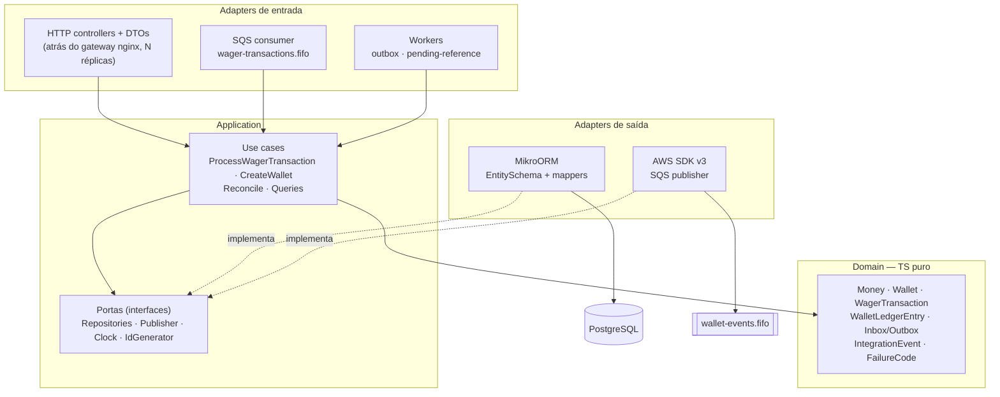
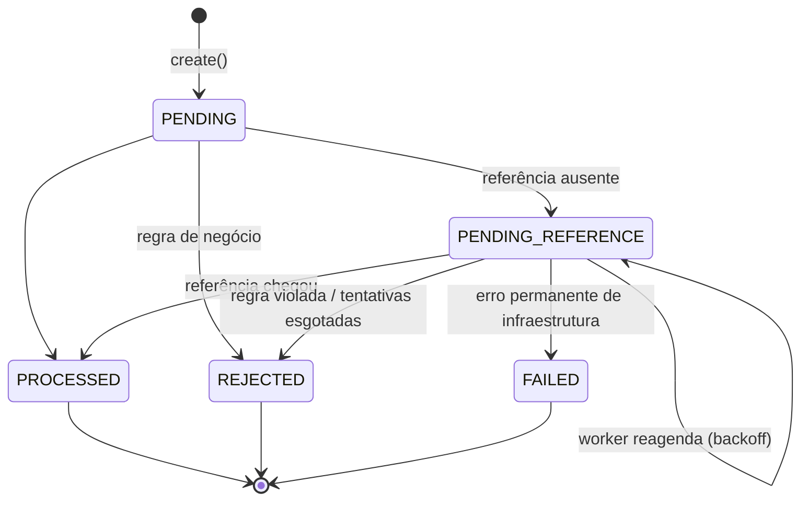

# Arquitetura

Decisões, trade-offs e limitações do processador de apostas. As referências `§N` apontam para o enunciado ([`docs/CHALLENGE.md`](docs/CHALLENGE.md)). O diário de execução, com a evidência de cada etapa, está em [`docs/PROGRESS.md`](docs/PROGRESS.md).

## 1. Visão geral

Arquitetura hexagonal em três contextos: **wallet** (saldo e ledger), **wagering** (regras de aposta, idempotência, referências) e **messaging** (inbox/outbox). O domínio é TypeScript puro — não importa NestJS nem MikroORM (§6.1) — e é testado sem banco. HTTP e SQS entram pelo **mesmo caso de uso** (`ProcessWagerTransactionUseCase`, §10), que conhece apenas portas (`UnitOfWork`, repositórios, `Clock`, `IdGenerator`).

**Portas e adaptadores.** Toda porta (interface de que um caso de uso precisa) fica em `<contexto>/application/ports/`, no contexto que a usa. Toda implementação concreta fica em `<contexto>/infrastructure/`. O domínio não tem portas: ele não faz I/O e recebe datas, ids e entidades já carregados.

| Porta (`application/ports/`) | Adaptador (`infrastructure/`) |
|---|---|
| `shared` · `UnitOfWork`, `Clock`, `IdGenerator` | `MikroOrmUnitOfWork`, `SystemClock`, `UuidV7Generator` |
| `wallet` · `WalletRepository`, `LedgerRepository` | `MikroOrmWalletRepository`, `MikroOrmLedgerRepository` |
| `wallet` · `ReconciliationMonitor` | `LoggingReconciliationMonitor` (log + métrica) |
| `wagering` · `WagerTransactionRepository` | `MikroOrmWagerTransactionRepository` |
| `messaging` · `InboxRepository`, `OutboxRepository`, `EventPublisher` | `MikroOrmInboxRepository`, `MikroOrmOutboxRepository`, `SqsEventPublisher` |
| `auth` · `ProviderIdentityPort` | `AnonymousProviderIdentity` (no-op, §2), usado pelo `ProviderAuthGuard` |

As portas de entrada são os próprios casos de uso (`ProcessWagerTransactionUseCase`, `CreateWalletUseCase`…). Os adaptadores de entrada são os controllers HTTP, o consumer SQS e os workers. Os módulos NestJS fazem a ligação entre portas e adaptadores.

Todas as instâncias são idênticas e sem estado: HTTP, consumer SQS, publisher da outbox e worker de referências rodam em todas, coordenados apenas pelo PostgreSQL. Não há eleição de líder nem lock global.

## 2. Persistência: MikroORM 7

**Por que MikroORM** (preferencial no §4): `em.transactional()`, `LockMode` e QueryBuilder com `onConflict().ignore()` cobrem exatamente o que o desenho precisa (transação explícita, `FOR UPDATE`, `FOR UPDATE SKIP LOCKED`, `INSERT … ON CONFLICT DO NOTHING`).

**Mapeamento:** entidades de domínio não têm decorators. A persistência usa `EntitySchema` sobre *records* simples (`WalletRecord`, `WagerTransactionRecord`…) e mappers que reconstroem o domínio pela factory `rehydrate` (§6.0). Motivos: o MikroORM 7 recusa construtor privado em `EntitySchema` e hidrata sem chamar o construtor; manter o domínio fora do ORM deixa `rehydrate` como o único caminho de reconstrução.

**Por que as escritas não usam o change tracking do Unit of Work.** Todas as leituras usam `disableIdentityMap` e todas as escritas são explícitas (`em.insert`, `em.nativeUpdate`). O schema tem um trigger que proíbe alterar transações em estado terminal; com change tracking, um `flush` poderia transformar uma entidade apenas *lida* (a BET referenciada por um REFUND, uma transação devolvida num replay) num `UPDATE` implícito, e o trigger abortaria a operação inteira. Com escritas explícitas, o SQL emitido é exatamente o pretendido. Há um teste que prova que a BET referenciada não é regravada (`updated_at` inalterado). A transação continua sendo do MikroORM (`em.fork().transactional()`), encapsulada pelo `MikroOrmUnitOfWork`.

**Migrations** são escritas à mão (`migration:create --blank`), com `up` e `down`, e listadas explicitamente em `migrations/index.ts`, sem snapshot. Um teste falha se existir arquivo de migration não registrado nessa lista (senão ele seria ignorado em silêncio). O diff automático não conhece triggers, índices parciais nem CHECKs compostos e tentaria removê-los. Há teste de `up → down → up`.

**Duas identidades no banco:** `wagering` (dona das tabelas, só migrations) e `wagering_app` (aplicação). A aplicação não tem `DELETE` em nenhuma tabela, não tem `UPDATE` no ledger e, por não ser dona, não consegue `ALTER TABLE … DISABLE TRIGGER`. Testado.

## 3. Dinheiro: `bigint` em unidades menores

`Money` guarda o valor como `bigint` em centavos (`"25.00"` ↔ `2500n`); as colunas são `*_minor bigint` + `currency char(3)` (§6.1 permite colunas separadas). A string decimal com 2 casas existe só nas bordas (HTTP, SQS, eventos). `number`, `float` e `double` nunca representam dinheiro (§5.1).

- **Por que não `numeric(19,2)` + `decimal.js`** (o esqueleto do §6.1 usa `Decimal`; o §6 permite adaptar assinaturas preservando as garantias): verificado no ambiente, `numeric(19,2)` grava `25.005` como `25.01` sem erro e aceita `NaN`; `decimal.js` aceita `1e3`, `0x1A` e `Infinity`. O desafio só exige somar, subtrair, inverter sinal e comparar — operações exatas em inteiros. É o padrão de ledgers (Stripe, Adyen, TigerBeetle).
- **Conversão** sem ponto flutuante: regex `^(0|[1-9]\d*)\.(\d{2})$` → `BigInt(inteiro) * 100n + BigInt(centavos)`; `toJSON` faz o inverso. Rejeita NaN, Infinity, notação científica, hex, separadores, vazio, mais de 2 casas e negativos em contratos de entrada.
- `bigint` não serializa em `JSON.stringify` (lança erro): dinheiro só sai do domínio por `Money.toJSON()`.
- Agregações (`SUM`) chegam do driver como string e viram `BigInt(...)`.
- **Guarda automática:** um teste varre o código de domínio, persistência, HTTP e SQS e falha se encontrar `parseFloat`, `parseInt`, `Number(`, `Math.`, `toFixed` ou `+` unário.
- **Escala fixa em 2** para todas as moedas, porque o §6.1 fixa a escala dos contratos. Expoentes ISO-4217 por moeda (JPY 0, KWD 3) exigiriam mudar o contrato de entrada; o modelo concentra a escala numa constante (`MINOR_UNIT_SCALE`).

## 4. Concorrência

**Estratégia: lock pessimista por wallet** — `SELECT … FOR UPDATE` na linha da wallet no início da transação, em `READ COMMITTED`, mais `CHECK (balance_minor >= 0)` no schema como última defesa.

- A unidade de lock é a `walletId` (§8): operações da mesma wallet serializam; wallets diferentes rodam em paralelo. Não há lock global (§5.6).
- Em `READ COMMITTED`, a segunda transação espera o commit da primeira e relê a linha já atualizada. Não há lost update nem `read → calculate → update` sem controle (§5.7), e não há retry de serialização (que `REPEATABLE READ`/`SERIALIZABLE` exigiriam).
- **Por que não optimistic locking com retry:** numa *hot wallet* (muitas apostas simultâneas no mesmo jogador), retries se acumulam e desperdiçam trabalho; o lock pessimista dá fila ordenada com custo previsível. `version` continua sendo gravada e conferida (`WHERE version = ?`) como checagem de sanidade.
- **Regra de ordem de locks:** todo caminho trava a wallet **antes** de ler ou escrever transações. O worker de referências lista os candidatos vencidos sem lock; para cada um, abre transação própria, trava a wallet e relê a transação (se outra instância já tratou o item, a releitura o descarta). Sem inversão de ordem, não há deadlock entre caminhos.
- **Esperas limitadas:** `SET LOCAL lock_timeout` (padrão 5 s) por transação e `connectionTimeoutMillis` no pool (padrão do `pg` = esperar para sempre). Estourou → `503` com `Retry-After` e métrica `wagering_lock_conflicts_total`.
- Cenário obrigatório do §8 (100.00, duas apostas de 80.00 simultâneas, inclusive em processos diferentes): uma `PROCESSED`, uma `REJECTED` (`INSUFFICIENT_FUNDS`), saldo 20.00, um débito.

## 5. Idempotência

- **Chave:** o header `Idempotency-Key` (ou `data.idempotencyKey` na fila) é a fonte da verdade, com `UNIQUE(idempotency_key)` no banco. `UNIQUE(provider_id, external_transaction_id)` também existe, porque referências são resolvidas por esse par (§7.2).
- **`payloadHash`** = SHA-256 (hex, minúsculo) do JSON canônico do subconjunto de negócio: `providerId, externalTransactionId, playerId, walletId, roundId, gameId, kind, money{amount,currency}, referenceExternalTransactionId`. Canônico = chaves ordenadas recursivamente (ordem de code units), propriedades `undefined` omitidas, sem espaços. Header, `messageId`, `occurredAt` e a própria key ficam fora.
- **Replay:** mesma key e mesmo hash → a mesma resposta (mesmo status HTTP, mesmo corpo, saldo observado na época, guardado na transação), com `idempotentReplay: true`. Hash diferente, ou o mesmo id externo com outra key → `409`.
- **Sob o lock:** a checagem acontece depois do `FOR UPDATE` da wallet; 50 duplicatas paralelas serializam e 49 encontram a linha comitada.
- **Corrida residual:** a mesma key com `walletId`s diferentes trava wallets diferentes; o `UNIQUE` do banco decide. A violação é traduzida, a transação é refeita só para leitura e devolve replay ou `409`. Como no PostgreSQL um erro de unicidade aborta a transação, a releitura usa uma transação nova.
- **Inbox (fila):** `INSERT … ON CONFLICT DO NOTHING` em `(consumer_name, message_id)` é o primeiro passo da mesma transação SQL; `processed_at` é gravado no último. A linha só existe se o processamento comitou. Redelivery de mensagem já processada devolve o resultado gravado sem disputar o lock da wallet; o mesmo `messageId` com outro conteúdo é erro permanente (DLQ).
- Nenhuma idempotência depende de memória (§5.2).

## 6. Domínio e estados

Entidades com construtor privado e factories (`create`/`open`/`from` validam; `rehydrate` só reconstrói, §6.0). A `Wallet` é a única que altera saldo; `debit`/`credit` devolvem o `WalletLedgerEntry`, então não existe alteração de saldo sem lançamento. `version` começa em 1 (o crédito de abertura não incrementa) e sobe só quando o saldo muda. `WalletLedgerEntry` é congelado (`Object.freeze`) e valida `before ± amount = after` na criação. As regras do §7 vivem num serviço de domínio puro (`settleWagerTransaction`), e o caso de uso só carrega, chama e persiste.

- `PENDING` só existe em memória; o schema não permite gravá-lo.
- `PROCESSED`, `REJECTED` e `FAILED` são terminais: transicionar lança `InvalidTransactionStateError`, e um trigger no banco também bloqueia `UPDATE` e `DELETE`.
- **Quando `FAILED` acontece:** no reprocessamento de uma referência pendente, um erro que não é de negócio nem transitório (bug, violação de constraint) marca a transação como `FAILED` com `INFRA_PERMANENT_FAILURE`, de forma auditável, e o worker segue para os demais itens. Sem isso, um único item problemático travaria o worker para sempre. Na entrada síncrona (HTTP/SQS), erros desse tipo desfazem a transação SQL inteira: não há linha a marcar e o provedor recebe `500`, ou a mensagem é retentada até a DLQ. O §11 não define evento para `FAILED`, então nenhum é emitido.
- Referências fora de ordem (§7.1): **10 tentativas** do worker depois da chegada, com backoff `2 s · 2ⁿ` (n = tentativas já feitas) e teto de 5 min: esperas de 2 s, 4 s, 8 s … 256 s, 300 s, 300 s, **~18,5 min** no total, configurável. A justificativa: referências fora de ordem chegam em segundos ou minutos (redelivery do provedor e da fila); ~18 min cobrem o backoff do SQS sem segurar dinheiro do jogador indefinidamente. Esgotado → `REJECTED` com `REFERENCE_NOT_FOUND` e evento `WagerTransactionRejected`.

## 7. Códigos de falha

`failureCode` estável, com a ação esperada do provedor (`retryable` vem no corpo das respostas `422`):

| Código | Status | Ação do provedor |
|---|---|---|
| `INSUFFICIENT_FUNDS` | REJECTED | desistir |
| `REVERSAL_INSUFFICIENT_FUNDS` (≠ do anterior, §7.9) | REJECTED | escalar (operacional) |
| `CURRENCY_MISMATCH` | REJECTED | corrigir payload |
| `WALLET_PLAYER_MISMATCH` | REJECTED | corrigir payload |
| `REFERENCE_NOT_FOUND` (tentativas esgotadas) | REJECTED | desistir / investigar |
| `REFERENCE_NOT_PROCESSED` (referência rejeitada ou falhou) | REJECTED | desistir |
| `REFERENCE_MISMATCH` (outro player, wallet, moeda ou rodada) | REJECTED | corrigir payload |
| `INVALID_REFERENCE_KIND` | REJECTED | corrigir payload |
| `REFERENCE_AMOUNT_MISMATCH` (reversão parcial fora de escopo) | REJECTED | corrigir payload |
| `REFERENCE_ALREADY_REVERSED` | REJECTED | desistir (já feito) |
| `INFRA_PERMANENT_FAILURE` | FAILED | escalar |

Erros que não viram transação: `INVALID_REQUEST`/`VALIDATION_ERROR` (400), `WALLET_NOT_FOUND`/`TRANSACTION_NOT_FOUND` (404), `IDEMPOTENCY_CONFLICT`/`WALLET_ALREADY_EXISTS` (409), `SERVICE_UNAVAILABLE` (503), `SCHEMA_GUARD_VIOLATION`/`INTERNAL_ERROR` (500). Mapeamento único em `http-error.filter.ts`.

## 8. Garantias no schema (§5.9)

| Garantia | Mecanismo |
|---|---|
| Uma wallet por player + moeda | `UNIQUE(player_id, currency)` |
| Saldo nunca negativo | `CHECK (balance_minor >= 0)` |
| Idempotência | `UNIQUE(idempotency_key)`, `UNIQUE(provider_id, external_transaction_id)` |
| Reversão única (qualquer kind) | índice único parcial em `reference_transaction_id` `WHERE kind IN ('REFUND','ROLLBACK') AND status = 'PROCESSED'` |
| Forma da transação | CHECKs de kind, status (`PENDING` nunca gravado), valor (> 0; `LOSS` ≥ 0), referência obrigatória/permitida/não vazia, `failure_code` ↔ status e da taxonomia, agendamento de `PENDING_REFERENCE` |
| Terminais imutáveis, campos de negócio imutáveis, sem `DELETE` | trigger `wager_transactions_guard_trg` |
| Um lançamento por transação por wallet | `UNIQUE(transaction_id, wallet_id)` |
| `before ± amount = after`; valores ≥ 0 | CHECKs no ledger |
| Lançamento na moeda da wallet e na wallet da transação | FKs compostas `(wallet_id, currency)` e `(transaction_id, wallet_id)` |
| Ledger append-only | triggers contra `UPDATE`/`DELETE` (linha) e `TRUNCATE` (statement), válidos até para a dona das tabelas |
| Dedup de mensagens | `PRIMARY KEY (consumer_name, message_id)` |

As FKs compostas, o CHECK aritmético e o trigger append-only tornam o ledger auditável no próprio schema: não existe lançamento órfão, em outra moeda, aritmeticamente inconsistente ou alterado depois de gravado.

## 9. Mensageria

**Consumer** (`wager-transactions.fifo`, §10), um loop próprio sobre o AWS SDK v3. A biblioteca `sqs-consumer` não espera a mensagem em andamento no `stop()` e não dá controle de backoff e DLQ.

| Resultado | Ação |
|---|---|
| processada, rejeitada por regra, pendente de referência, replay | `DeleteMessage` (ack) **depois do commit** |
| permanente: JSON/contrato inválido, `OPENING`, conflito de idempotência, `messageId` reutilizado, wallet inexistente | envia à DLQ com `failureReason` e remove da origem |
| transitório: banco, lock, fila | `ChangeMessageVisibility` com backoff por `ApproximateReceiveCount` |
| tentativas ≥ `SQS_MAX_ATTEMPTS` (5) | DLQ com `MAX_ATTEMPTS_EXCEEDED` (a `RedrivePolicy` da fila é a rede de segurança) |

- `MessageGroupId` = wallet. O FIFO do SQS é otimização; a garantia vem do banco (§5.3).
- **Ordem do grupo FIFO no lote:** o lote é processado em sequência. Se uma mensagem é reagendada (falha transitória), as seguintes do mesmo `MessageGroupId` naquele lote não são processadas: ficam invisíveis pelo mesmo tempo e voltam depois dela, na ordem. Mensagem enviada à DLQ não bloqueia o grupo. Custo: o `ApproximateReceiveCount` dessas mensagens também sobe; se a anterior esgotar as tentativas, a `RedrivePolicy` pode levá-las à DLQ sem processar (mesmo comportamento do Lambda com SQS FIFO). A inbox e a idempotência continuam sendo a garantia de consistência (§5.3).
- **SIGTERM:** para de buscar, cancela o long polling (`AbortController`), conclui a mensagem em andamento e devolve as não iniciadas com visibilidade 0. Medido no container: `docker stop` em ~0,2 s, exit 0. Uma falha do SQS ao confirmar uma mensagem não aborta o resto do lote.
- **Crash depois do commit e antes do ack:** a mensagem reaparece quando a visibilidade expira, e a inbox transforma a redelivery em replay. Há teste com `SIGKILL` real.

**Transactional outbox** (§11): eventos gravados na mesma transação SQL da alteração financeira e publicados depois por um worker em cada instância. Cada lote é reivindicado com `FOR UPDATE SKIP LOCKED`, publicado (`SendMessageBatch`, falha parcial tratada) e marcado como publicado ou reagendado com backoff, na mesma transação. Se o processo morrer antes do commit, o lock é liberado e outra instância republica: entrega **at-least-once**, com duplicatas identificáveis pelo `eventId` (que também é o `MessageDeduplicationId` no SQS).

- **Ordem dos eventos:** com `SKIP LOCKED` e vários publishers, dois eventos da mesma wallet podem ser publicados fora da ordem de ocorrência no mesmo grupo FIFO. O §11 exige não perder nem duplicar indefinidamente, não exige ordem. `WalletBalanceChanged` carrega `walletVersion`, que permite ao consumidor ordenar e descartar eventos obsoletos.
- `aggregateId` dos eventos = `walletId` (unidade de concorrência). O `transactionId` vai em `data`.
- Eventos emitidos pelo worker de referências usam `correlationId = idempotencyKey`, porque o `correlationId` da requisição original não é persistido.

## 10. Autenticação (não implementada)

Não pontua (§2) e foi deixada de fora para concentrar o tempo em correção financeira, concorrência e mensageria. O ponto de extensão existe: `ProviderAuthGuard` (no-op) aplicado aos controllers de wallet e wagering, e a porta `ProviderIdentityPort` (implementação `AnonymousProviderIdentity`). Health, métricas e a fila ficam fora do guard.

**Desenho previsto:** Keycloak (OIDC) no Compose, com um client por provedor no fluxo *client credentials*. Um adapter de `ProviderIdentityPort` valida o JWT pelo JWKS do realm (assinatura, `iss`, `aud`, `exp`) e extrai o `providerId` de uma claim. O guard exige identidade e compara o `providerId` autenticado com o do payload: divergência → `403`. Mensagens da fila são canal interno confiável, mas o `providerId` delas passa pelas mesmas validações de domínio.

## 11. Observabilidade

- **Logs:** pino em JSON no stdout, sem transport (transports travam o shutdown sob Bun). Um `AsyncLocalStorage` injeta `correlationId`, `messageId`, `transactionId`, `walletId` e `providerId` em toda linha. Há uma linha por transação tratada (HTTP, SQS e worker), com `kind`, `status`, `failureCode` e replay. Payloads e valores monetários nunca são logados; uma lista de redação censura qualquer um que escape.
- **Métricas** (`GET /metrics`, Prometheus, labels sem ids):

| §12 | Métrica |
|---|---|
| transações por status | `wagering_transactions_total{status,kind,source}` (`source` = http, sqs, worker) |
| duplicatas | `wagering_duplicates_detected_total{kind,source}` (replay, conflito de key, `messageId` reutilizado) |
| retries | `wagering_retries_total{component,reason}` |
| DLQ | `wagering_dlq_messages_total{reason}` |
| conflitos de lock | `wagering_lock_conflicts_total{sqlstate}` |
| outbox lag | `wagering_outbox_lag_seconds`, `wagering_outbox_pending` (consultados a cada scrape) |
| latência | `wagering_processing_duration_seconds{source,outcome}`, `wagering_http_request_duration_seconds{method,route,status}` |
| extras | `wagering_outbox_published_total`, `wagering_pending_reference_outcomes_total`, `wagering_reconciliation_mismatches_total` (§9), `wagering_schema_guard_violations_total` |

- As métricas padrão de processo foram omitidas de propósito: sob Bun, `eventLoopUtilization()` sempre retorna zero (oven-sh/bun#34068), e publicar zeros seria enganoso.
- `/metrics` não exige autenticação, assim como `/health`. Em produção, ficaria restrito à rede interna.
- **Health:** `/health/live` (processo, sem dependências) e `/health/ready` (`select 1` + `GetQueueAttributes`, timeout de 2 s cada; `503` durante o shutdown).
- **Reconciliação:** divergência é logada, contabilizada e sinalizada (`consistent: false`), e nunca é corrigida.

## 12. Interpretações

Onde o enunciado é omisso ou ambíguo (§7: "qualquer interpretação adicional adotada deve ser documentada"):

1. **Uma reversão por referência, de qualquer kind.** O §7.4 proíbe reverter duas vezes "pelo mesmo tipo"; não autoriza tipos diferentes. A tabela do §7 diz que REFUND e ROLLBACK revertem "uma única vez", e o §3 proíbe duplicar créditos. REFUND e ROLLBACK da mesma BET creditariam o valor duas vezes.
2. **Wallet inexistente → `404`**, sem gravar a transação (que exige `walletId` válido por FK). É o mesmo código dos GETs, para manter a consistência que o §9 exige.
3. **O mesmo `(providerId, externalTransactionId)` com outra idempotency key → `409`.**
4. **Valores:** `Money` aceita `0.00` (o §6.1 só rejeita negativos); `LOSS` aceita `0.00` ou positivo. BET, WIN, REFUND e ROLLBACK com `0.00` → `400`: exigem um lançamento, e um lançamento sem alteração de saldo viola o "e vice-versa" do §6.2. O `OPENING` só existe quando o saldo inicial é maior que zero.
5. **Referência existente, mas ainda pendente**, é tratada como ausente (`PENDING_REFERENCE`).
6. **WIN com referência** segue as regras de pertencimento e exige referência do tipo BET.
7. **Destino dos eventos:** uma fila SQS (`wallet-events.fifo`), porque o §4 define SQS e o §11 não nomeia o destino.
8. **Conflito de idempotência vindo da fila → DLQ**, por exigir intervenção humana.
9. **Replay de uma transação que estava `PENDING_REFERENCE` e já foi resolvida** devolve o estado atual.
10. **Referência só onde o README prevê:** obrigatória em REFUND e ROLLBACK, opcional em WIN. Em BET ou LOSS → `400`, em vez de ser ignorada.
11. **`aggregateId` dos eventos é a wallet.**
12. **Backoff do domínio é determinístico** (`base · 2ⁿ` com teto).
13. **Consequência da interpretação 1:** depois de BET → REFUND → ROLLBACK do REFUND, a BET continua contando como revertida (o REFUND segue `PROCESSED`). Ela não pode ser reembolsada de novo, mesmo com o efeito líquido restaurado.
14. **Referência vazia** (`""` ou só espaços) → `400`, nunca "aguardando referência".

Outras escolhas no mesmo espírito: `providerId: "internal"` é reservado ao `OPENING` (`400`). Uma transação `FAILED` responde `500` no replay.

## 13. Testes

**354 testes, 0 falhas, 99,5% das linhas e 96,9% das funções cobertas** (`bun run test:coverage`, as três suítes num só processo). Integração e concorrência rodam contra PostgreSQL e MiniStack reais. Os testes de múltiplas instâncias usam processos reais (`bun src/main.ts`), cada um com pool, consumer e workers próprios. Todo arquivo de teste que movimenta saldo verifica o invariante `wallet.balance == saldo reconstruído pelo ledger` (e `version = 1 + movimentos`): os de HTTP por wallet, e os de mensageria e atomicidade num `afterEach` que confere todas as wallets criadas no teste, inclusive depois de falhas simuladas. Nos cenários com processos, ele é verificado numa única consulta para todas as wallets do cenário, junto com `version = 1 + movimentos` e saldo ≥ 0.

| §13 | Arquivo |
|---|---|
| Unidade: Money (escala, arredondamento, inválidos), Wallet, BET/WIN/LOSS/REFUND/ROLLBACK, moeda, key com payload divergente | `test/unit/shared/money.test.ts`, `test/unit/wallet/*`, `test/unit/wagering/*` |
| Migrations e constraints | `test/integration/schema/*` |
| Atomicidade wallet/ledger/inbox/outbox | `test/integration/application/atomicity-and-transient.test.ts` |
| Inbox e redelivery; retry e DLQ; ordem do grupo FIFO no lote | `test/integration/messaging/consumer.test.ts` |
| Publishers concorrentes | `test/integration/messaging/outbox-publisher.test.ts` |
| Recuperação após reinicialização | `test/concurrency/multi-instance.test.ts` |
| Conc. 1 — 50× em paralelo | `test/concurrency/http-concurrency.test.ts` e `multi-instance.test.ts` (em 3 processos) |
| Conc. 2 — disputa de saldo (§8) | idem, inclusive com as apostas em processos diferentes |
| Conc. 3 — wallets distintas em paralelo | idem |
| Conc. 4 — ≥ 3 instâncias | `multi-instance.test.ts` (HTTP; 3 consumers + 3 publishers) |
| Conc. 5 — worker morto depois do commit e antes do ack | `multi-instance.test.ts` (`FAULT_INJECTION` → `SIGKILL`; prova pela métrica de replay na instância sobrevivente) |
| Conc. 6 — dois publishers na mesma outbox | `outbox-publisher.test.ts` (interseção vazia entre o que cada um publicou) |
| Conc. 7 — ROLLBACK/REFUND antes da referência | `test/integration/messaging/pending-references.test.ts` e `multi-instance.test.ts` |
| `FAILED` (erro permanente ao reprocessar uma referência) sem travar o worker | `pending-references.test.ts` (item envenenado vira `FAILED`; o vizinho é processado) |
| Conc. 8 — reinício com consistência final | `multi-instance.test.ts` (`SIGKILL` nas 3 instâncias no meio de carga HTTP + SQS, com prova de que havia trabalho pendente, e reinício) |

Uma guarda da regra eliminatória falha se aparecer conversão de dinheiro para ponto flutuante (seção 3).

## 14. Limitações e trade-offs conhecidos

- **Escala fixa em 2 casas** para todas as moedas (§6.1). Moedas com expoente ISO-4217 diferente exigiriam mudar o contrato.
- **Hot wallet:** o lock pessimista serializa as operações de uma mesma wallet. A vazão por wallet é limitada pela latência de uma transação; a vazão total escala com o número de wallets.
- **Ordem dos eventos publicados** não é garantida entre publishers (seção 9).
- **`correlationId` dos eventos do worker** é a idempotency key, não o id da requisição original (seção 9).
- **Reversão única** inclui o caso BET → REFUND → ROLLBACK do REFUND (interpretação 13).
- **Pool e lock esgotados viram `503`** depois de `DATABASE_CONNECTION_TIMEOUT_MS` / `LOCK_TIMEOUT_MS`, e o provedor reenvia. Não há fila interna nem backpressure além disso.
- **Inbox e outbox crescem** sem limpeza. Em produção, haveria uma rotina de expurgo (por exemplo, inbox processada há mais de N dias e outbox publicada), fora do escopo.
- **Autenticação** não implementada (seção 10).
- **Teste de carga** ([`docs/LOAD_TEST.md`](docs/LOAD_TEST.md)): ~435 transações/s em muitas wallets e ~256/s numa wallet só (o teto do lock por wallet; no máximo ~3,9 ms de lock por transação, valor confundido com a saturação de CPU), 0% de erro e invariante intacto. Ambiente de 4 CPUs compartilhadas: 3 réplicas renderam menos que 1 (CPU saturada), e o MiniStack limita a publicação (~140 eventos/s) e a ingestão (~55 msg/s). O ganho de escalar horizontalmente não foi medido.

### MiniStack em vez de LocalStack

Os dois são aceitos (§4). Desde a versão 2026.03, o LocalStack exige token de licença, o que dificultaria o avaliador subir o ambiente. O MiniStack 1.5.24 implementa o que o desafio usa (FIFO, dedup, `RedrivePolicy`, `ApproximateReceiveCount`, long polling, visibilidade). Limitações relevantes:

- **DLQ standard aceita:** o MiniStack aceita uma DLQ standard para uma fila FIFO, o que a AWS rejeita. As filas usam DLQ FIFO, e um teste confere isso (`test/integration/messaging/queues.test.ts`).
- **Sem quotas nem throttling:** não serve para medir throughput.
- **Estado em memória:** as filas são recriadas pelo init script a cada subida.
- **Init script que falha passa despercebido:** o endpoint `/ready` fica "pronto" mesmo se o script falhar. O healthcheck do Compose também confere se a fila existe.

O mesmo init script funciona no LocalStack (`/etc/localstack/init/ready.d`).
