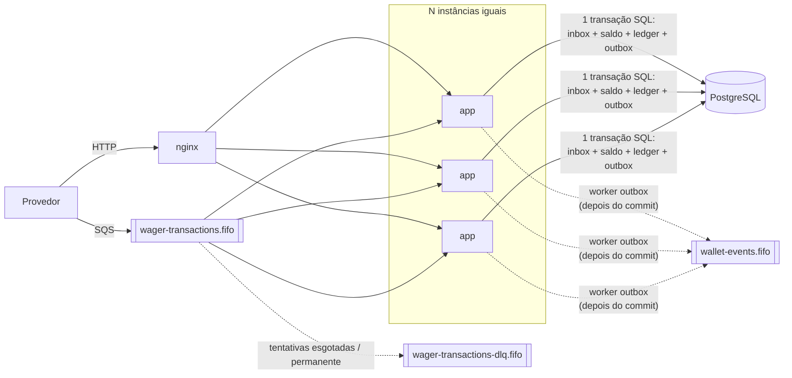

# Distributed Wagering Processor

Serviço financeiro distribuído que processa transações de apostas (`BET`, `WIN`, `LOSS`, `REFUND`, `ROLLBACK`) recebidas de provedores de jogos por **HTTP** e por **SQS**. Saldo e ledger continuam consistentes sob entrega duplicada, fora de ordem e concorrente, com várias instâncias rodando ao mesmo tempo.

- **Stack:** Bun 1.4 · TypeScript strict · NestJS 12 · MikroORM 7 · PostgreSQL 18 · SQS (MiniStack) · Docker Compose
- **Enunciado do desafio:** [`docs/CHALLENGE.md`](docs/CHALLENGE.md). As referências `§N` neste repositório apontam para as seções dele.
- **Página de estrutura (diagramas de camadas, domínio, dados, fluxos e falhas):** [`docs/architecture-overview.html`](docs/architecture-overview.html), que abre direto no navegador; com o ambiente no ar, também em <http://localhost:43180/arquitetura>
- **Decisões, trade-offs e limitações:** [`ARCHITECTURE.md`](ARCHITECTURE.md)

---

## Sumário

1. [Visão geral](#visão-geral)
2. [Documentação](#documentação)
3. [Requisitos](#requisitos)
4. [Início rápido](#início-rápido)
5. [Ferramentas de visualização](#ferramentas-de-visualização-opcionais)
6. [Ambiente de demonstração](#ambiente-de-demonstração-opcional)
7. [Arquitetura em resumo](#arquitetura-em-resumo)
8. [Garantias e onde estão](#garantias-e-onde-estão)
9. [API](#api)
10. [Entrada por SQS](#entrada-por-sqs)
11. [Verificar o invariante](#verificar-o-invariante-walletbalance--ledger)
12. [Testes](#testes)
13. [Observabilidade](#observabilidade)
14. [Configuração](#configuração)
15. [Comandos úteis](#comandos-úteis)
16. [Estrutura do repositório](#estrutura-do-repositório)
17. [Limitações conhecidas](#limitações-conhecidas)

---

## Visão geral



- **Instâncias idênticas e sem estado.** HTTP, consumer SQS, publisher da outbox e worker de referências pendentes rodam em todas. Elas se coordenam só pelo PostgreSQL: não há eleição de líder nem lock global.
- **Uma transação SQL por operação.** Inbox, transação, saldo, ledger e outbox são gravados juntos (§6.5). O evento só é **publicado** depois do commit, por um worker separado (§5.4).
- **Lock por wallet.** Operações da mesma wallet serializam com `SELECT … FOR UPDATE`; wallets diferentes rodam em paralelo (§8).
- **Idempotência no banco.** A `Idempotency-Key` e o par `(provider, externalTransactionId)` são `UNIQUE`. Um replay devolve a resposta original, e a mesma key com outro payload resulta em `409` (§5.2, §9).
- **Dinheiro em `bigint` (centavos)** no domínio e no banco; a string `"25.00"` existe só nas bordas (§5.1).

## Documentação

| Documento | Conteúdo |
|---|---|
| [`docs/architecture-overview.html`](docs/architecture-overview.html) (também servida em <http://localhost:43180/arquitetura>) | **Estrutura do projeto em pranchas:** camadas hexagonais, pastas, modelo de domínio, Money em bigint, estados da transação, regras por operação, modelo de dados e garantias do schema, fluxo transacional, concorrência, inbox/outbox/SQS, cenários de falha e contrato HTTP |
| [`ARCHITECTURE.md`](ARCHITECTURE.md) | Decisões e justificativas (ORM, Money, locking, idempotência e hash, estados, failure codes, mensageria, auth), as 14 interpretações do enunciado, mapa §13 → testes, limitações |
| [`docs/openapi.yaml`](docs/openapi.yaml) | Contrato OpenAPI com exemplos reais por código de resposta (servido no Swagger UI em `/docs`) |
| [`docs/CHALLENGE.md`](docs/CHALLENGE.md) | Enunciado original do desafio |
| [`docs/LOAD_TEST.md`](docs/LOAD_TEST.md) | Teste de carga: metodologia, throughput, latências, conflitos, outbox lag e ressalvas |
| [`docs/DEPLOY.md`](docs/DEPLOY.md) | Ambiente de demonstração opcional (local ou num servidor com Docker): o que muda em relação ao local e como subir |
| [`docs/PLAN.md`](docs/PLAN.md) | Plano de implementação por fases (documento de trabalho) |
| [`docs/PROGRESS.md`](docs/PROGRESS.md) | Diário de execução com a evidência de cada etapa, incluindo a revisão de código final |
| [`docs/tech/`](docs/tech) | Guias de estudo das tecnologias: Bun/TypeScript, NestJS, MikroORM, PostgreSQL, SQS/MiniStack, dinheiro e observabilidade |

## Requisitos

| Ferramenta | Versão | Observação |
|---|---|---|
| Docker + Docker Compose | Docker 24+, Compose v2 | PostgreSQL, MiniStack, app e gateway |
| Bun | **1.4.2** | `curl -fsSL https://bun.sh/install \| bash -s "bun-v1.4.2"` (sem sudo). Só para rodar testes e scripts no host |

## Início rápido

```bash
cp .env.example .env              # variáveis do ambiente local (credenciais só de desenvolvimento)
docker compose up -d --wait       # postgres + ministack + migrate + app + gateway
curl localhost:43180/health/ready # {"status":"ok","checks":{"database":"up","sqs":"up"}}
```

Com várias instâncias da aplicação (o gateway nginx distribui as requisições):

```bash
docker compose up -d --wait --scale app=3   # ~15 s com as imagens em cache
```

| Serviço | Porta no host | Por quê |
|---|---|---|
| gateway (nginx → app) | `43180` (`APP_PORT`) | porta alta para não colidir com serviços locais em 3000/8080 |
| PostgreSQL | `55432` (`POSTGRES_PORT`) | 5432 costuma estar ocupada por um Postgres local |
| MiniStack (SQS) | `4566` | padrão de emuladores AWS |

O serviço `migrate` aplica as migrations uma vez, antes da app. Na primeira subida, o PostgreSQL cria duas identidades:

- `wagering`: dona das tabelas, usada só nas migrations;
- `wagering_app`: usada pela aplicação. Não tem `DELETE`, não tem `UPDATE` no ledger e não pode desligar triggers.

O MiniStack cria as filas `wager-transactions.fifo`, `wager-transactions-dlq.fifo` (DLQ) e `wallet-events.fifo` (eventos publicados).

## Ferramentas de visualização (opcionais)

```bash
docker compose --profile tools up -d --wait   # sobe também Swagger UI, pgweb e sqs-admin
bun run demo                                  # popula o ambiente com um caso de cada tipo
```

| O quê | Link | Acesso |
|---|---|---|
| API: Swagger UI ("Try it out") | http://localhost:43180/docs | spec em `docs/openapi.yaml` |
| Banco: pgweb (já conectado, sem login) | http://localhost:43181 | cliente desktop (DBeaver, TablePlus, psql): `localhost:55432`, usuário `wagering`, senha `wagering`, base `wagering` |
| Filas: sqs-admin | http://localhost:43182 | — |
| Filas: inspeção sem consumir (MiniStack) | `http://localhost:4566/_ministack/sqs/messages?QueueUrl=http://localhost:4566/000000000000/<fila>` | — |
| Métricas | http://localhost:43180/metrics | — |
| Readiness | http://localhost:43180/health/ready | — |
| Página de estrutura (arquitetura em diagramas) | http://localhost:43180/arquitetura | — |

O `bun run demo` cria três wallets e exercita:

- BET, replay idempotente e conflito de idempotência (409);
- WIN com referência, LOSS e REFUND;
- disputa de saldo simultânea (§8: 201 + 422);
- ROLLBACK antes da BET (202), com a BET chegando pela fila;
- uma mensagem malformada que vai para a DLQ.

Ao final, imprime a reconciliação de cada wallet. O `wallet-events.fifo` não tem consumidor neste projeto, então os eventos publicados ficam visíveis no sqs-admin.

Para voltar a um banco só com os dados da demonstração (o teste de carga deixa milhares de transações `provider-load`):

```bash
docker compose down -v && docker compose --profile tools up -d --wait && bun run demo
```

## Ambiente de demonstração (opcional)

Uma versão "pronta para mostrar": a mesma aplicação, com 3 réplicas, sem nenhuma autenticação acrescentada (§2), dados de exemplo gerados e ferramentas de inspeção do banco e das filas **somente leitura**. Sobe localmente com um comando e também pode ser publicada num servidor com Docker.

```bash
scripts/deploy-demo.sh --local   # http://localhost:48080 (página, API, /docs, /arquitetura) · :48081 (pgweb) · :48082 (filas)
```

- configuração: `docker-compose.demo.yml`;
- num servidor: `scripts/deploy-demo.sh <ip>`;
- diferenças em relação ao ambiente local e passo a passo: [`docs/DEPLOY.md`](docs/DEPLOY.md).

## Arquitetura em resumo

Arquitetura hexagonal com DDD tático, em três contextos de negócio:

- **wallet:** saldo e ledger;
- **wagering:** regras de aposta, idempotência e referências;
- **messaging:** inbox e outbox.

Cada contexto se divide em `domain` / `application` / `infrastructure`:

| Camada | O que contém | Depende de |
|---|---|---|
| `domain` | Entidades e value objects em TypeScript puro (`Money`, `Wallet`, `WagerTransaction`, `WalletLedgerEntry`, inbox/outbox, eventos). Construtor privado e factories (`create`, `open`, `rehydrate`) | nada (nem NestJS nem MikroORM) |
| `application` | Casos de uso e **portas** em `application/ports/` (`UnitOfWork`, repositórios, `EventPublisher`, `Clock`, `IdGenerator`) | `domain` |
| `infrastructure` | **Adaptadores:** controllers HTTP, consumer SQS, workers, repositórios MikroORM, publisher SQS, logger, métricas | `application`, `domain` |

HTTP e SQS entram pelo **mesmo caso de uso** (`ProcessWagerTransactionUseCase`, §10). O mapa completo porta → adaptador está no [`ARCHITECTURE.md` §1](ARCHITECTURE.md#1-visão-geral), e os diagramas, na página de estrutura (<http://localhost:43180/arquitetura> ou [`docs/architecture-overview.html`](docs/architecture-overview.html)).

**Fluxos principais:**

1. **Submissão (HTTP ou SQS):**
   - `BEGIN`;
   - inbox, só no SQS (`ON CONFLICT DO NOTHING`);
   - `SELECT wallet FOR UPDATE`;
   - busca pela idempotency key: replay ou `409`;
   - o domínio aplica a regra;
   - grava transação, saldo, ledger e outbox;
   - `COMMIT`;
   - responde (HTTP) ou dá `DeleteMessage` (SQS), **sempre depois do commit**.
2. **Outbox:** em cada instância, um worker reivindica eventos pendentes com `FOR UPDATE SKIP LOCKED`, publica no `wallet-events.fifo` e marca como publicado (ou reagenda com backoff) na mesma transação. A entrega é at-least-once, com `eventId` para deduplicar.
3. **Referência fora de ordem** (ex.: ROLLBACK antes da BET): a transação fica `PENDING_REFERENCE` (HTTP `202`). Um worker tenta resolvê-la 10 vezes com backoff (2 s até 5 min, ~18,5 min no total) e, esgotadas as tentativas, rejeita com `REFERENCE_NOT_FOUND` (§7.1). Antes de reler a transação, o worker trava a wallet, na mesma ordem de locks do caminho HTTP.
4. **Consumer SQS:**
   - erro de negócio: ack;
   - transitório: nova visibilidade com backoff;
   - permanente ou tentativas esgotadas: DLQ com `failureReason`;
   - SIGTERM: conclui a mensagem em andamento e devolve as demais.

   Dentro do lote, uma mensagem reagendada segura as seguintes do mesmo grupo FIFO.

## Garantias e onde estão

As restrições eliminatórias do enunciado e onde cada uma é garantida:

| Garantia | Como | Onde é provada |
|---|---|---|
| Dinheiro sem ponto flutuante (§5.1) | `Money` com `bigint` em centavos; colunas `*_minor bigint`; regex `^(0\|[1-9]\d*)\.(\d{2})$` nas bordas | `test/unit/shared/money.test.ts` e uma guarda que varre o código monetário atrás de `parseFloat`, `Number(`, `Math.*` (`test/unit/monetary-guard.test.ts`) |
| Idempotência persistente (§5.2) | `UNIQUE(idempotency_key)`, `UNIQUE(provider_id, external_transaction_id)`, hash SHA-256 do payload canônico | `test/integration/http/wagering.http.test.ts`, `test/integration/schema/constraints.test.ts` |
| Não depender do FIFO do SQS (§5.3) | inbox `PK(consumer_name, message_id)` + idempotência na mesma transação | `test/integration/messaging/consumer.test.ts` |
| Nada publicado antes do commit (§5.4) | transactional outbox + worker com `SKIP LOCKED` | `test/integration/messaging/outbox-publisher.test.ts` |
| Ledger append-only (§5.5) | triggers contra `UPDATE`/`DELETE`/`TRUNCATE`; a role da app só tem `SELECT, INSERT` no ledger | `test/integration/schema/constraints.test.ts`, `privileges.test.ts` |
| Lock por wallet, sem lock global (§5.6, §5.7) | `SELECT … FOR UPDATE` em `READ COMMITTED`, `lock_timeout` limitado, `version` conferida | `test/concurrency/http-concurrency.test.ts` (50× em paralelo, disputa de saldo do §8) |
| Correto com ≥ 3 instâncias (§5.8) | instâncias sem estado, coordenadas pelo banco | `test/concurrency/multi-instance.test.ts` (3 processos reais, crash depois do commit, `SIGKILL` geral e reinício) |
| Garantias no schema (§5.9) | `CHECK (balance_minor >= 0)`, aritmética do lançamento, reversão única (índice único parcial), estados terminais imutáveis (trigger) | `test/integration/schema/*` |
| Mesma transação SQL (§6.5) | `UnitOfWork` com `em.transactional()` envolvendo inbox, transação, saldo, ledger e outbox | `test/integration/application/atomicity-and-transient.test.ts` |

## API

Base: `http://localhost:43180`. Valores monetários são **strings decimais com 2 casas** (`"25.00"`), nunca números. Contrato completo: Swagger UI em `/docs` ou [`docs/openapi.yaml`](docs/openapi.yaml).

| Método | Rota | Descrição |
|---|---|---|
| `POST` | `/wallets` | Cria a wallet; saldo inicial > 0 gera a transação interna `OPENING` + `CREDIT` |
| `GET` | `/wallets/:walletId` | Saldo e `version` |
| `GET` | `/wallets/:walletId/ledger?cursor=&limit=50` | Lançamentos em ordem, com cursor opaco e estável (`limit` 1–100) |
| `POST` | `/wallets/:walletId/reconciliation` | Compara o saldo armazenado com o reconstruído pelo ledger (nunca corrige) |
| `POST` | `/wagering/transactions` | Submete uma transação (header `Idempotency-Key` obrigatório) |
| `GET` | `/wagering/transactions/:transactionId` | Consulta pelo id interno |
| `GET` | `/providers/:providerId/wagering/transactions/:externalTransactionId` | Consulta pelo id do provedor |
| `GET` | `/health/live` · `/health/ready` | Liveness · readiness (PostgreSQL + SQS) |
| `GET` | `/metrics` | Métricas Prometheus |

A API não tem autenticação, por decisão de escopo documentada no [`ARCHITECTURE.md` §10](ARCHITECTURE.md#10-autenticação-não-implementada). O guard `ProviderAuthGuard` e a porta `ProviderIdentityPort` são o ponto de extensão.

### Exemplo

```bash
PLAYER=$(uuidgen | tr A-Z a-z)

# 1. Criar a wallet
WALLET=$(curl -s -X POST localhost:43180/wallets -H 'content-type: application/json' \
  -d "{\"playerId\":\"$PLAYER\",\"initialBalance\":{\"amount\":\"1000.00\",\"currency\":\"BRL\"}}" \
  | python3 -c 'import sys,json;print(json.load(sys.stdin)["id"])')

# 2. Apostar (repita o mesmo comando: mesma resposta, mesmo status, "idempotentReplay": true)
curl -s -X POST localhost:43180/wagering/transactions -H 'content-type: application/json' \
  -H "Idempotency-Key: provider-a:transaction-$PLAYER" \
  -d "{\"providerId\":\"provider-a\",\"externalTransactionId\":\"transaction-$PLAYER\",\"playerId\":\"$PLAYER\",
       \"walletId\":\"$WALLET\",\"roundId\":\"round-987\",\"gameId\":\"fortune-chimp\",\"kind\":\"BET\",
       \"money\":{\"amount\":\"25.00\",\"currency\":\"BRL\"}}"
# {"transactionId":"…","status":"PROCESSED","balance":{"amount":"975.00","currency":"BRL"},"idempotentReplay":false}

# 3. Ledger e reconciliação
curl -s "localhost:43180/wallets/$WALLET/ledger?limit=50"
curl -s -X POST "localhost:43180/wallets/$WALLET/reconciliation"
```

### Status HTTP (iguais em todos os endpoints)

| Situação | Status | Reenviar? |
|---|---|---|
| Processada / wallet criada | `201` | — |
| Aceita, aguardando a transação referenciada (`PENDING_REFERENCE`) | `202` | não precisa |
| Payload inválido (inclui `Idempotency-Key` ausente, `OPENING`, valor fora do formato) | `400` | só corrigido |
| Recurso inexistente | `404` | depois de criá-lo |
| Mesma idempotency key com outro payload · wallet duplicada | `409` | não |
| Rejeição por regra de negócio (corpo traz `failureCode` e `retryable`) | `422` | não |
| Falha transitória (banco, lock, fila), com `Retry-After` | `503` | sim, com backoff |
| Erro interno / transação `FAILED` | `500` | não |

- **Replay:** devolve **o mesmo status e o mesmo corpo** da primeira resposta, inclusive o saldo observado naquele momento, com `idempotentReplay: true`.
- **Erros:** o corpo é `{ "code", "message", "retryable" }`.
- **Códigos de rejeição:** a taxonomia de `failureCode` está em [`ARCHITECTURE.md` › Códigos de falha](ARCHITECTURE.md#7-códigos-de-falha).

## Entrada por SQS

O consumer de `wager-transactions.fifo` usa o mesmo caso de uso do HTTP. Para enviar uma mensagem ao ambiente local (substitua os ids):

```bash
docker compose exec -T -e AWS_ACCESS_KEY_ID=test -e AWS_SECRET_ACCESS_KEY=test ministack \
  aws --endpoint-url http://localhost:4566 --region us-east-1 sqs send-message \
  --queue-url http://localhost:4566/000000000000/wager-transactions.fifo \
  --message-group-id "$WALLET" --message-deduplication-id "msg-$PLAYER" \
  --message-body "{\"messageId\":\"msg-$PLAYER\",\"type\":\"WagerTransactionRequested\",\"occurredAt\":\"2026-07-29T15:00:00.000Z\",
    \"data\":{\"providerId\":\"provider-a\",\"externalTransactionId\":\"sqs-$PLAYER\",\"idempotencyKey\":\"provider-a:sqs-$PLAYER\",
    \"playerId\":\"$PLAYER\",\"walletId\":\"$WALLET\",\"roundId\":\"round-987\",\"gameId\":\"fortune-chimp\",\"kind\":\"BET\",
    \"money\":{\"amount\":\"10.00\",\"currency\":\"BRL\"}}}"

sleep 2   # o consumer faz long polling; a mensagem é processada em instantes
curl -s "localhost:43180/providers/provider-a/wagering/transactions/sqs-$PLAYER"
```

| Resultado | Ação |
|---|---|
| processada, rejeitada por regra, pendente de referência, replay | ack (`DeleteMessage`) depois do commit |
| transitório (banco, lock, fila) | volta à fila com backoff; as mensagens seguintes do mesmo grupo no lote esperam junto |
| permanente (JSON/contrato inválido, conflito de idempotência, wallet inexistente) ou tentativas esgotadas | `wager-transactions-dlq.fifo` com o atributo `failureReason` |

## Verificar o invariante `wallet.balance == ledger`

Por wallet, via API:

```bash
curl -s -X POST localhost:43180/wallets/$WALLET/reconciliation
# {"storedBalance":…,"calculatedBalance":…,"difference":{"amount":"0.00",…},"consistent":true,"checkedEntries":…}
```

Para todas as wallets, direto no banco (lista vazia = consistente):

```bash
docker compose exec -T postgres psql -U wagering -d wagering -c "
  select w.id, w.balance_minor, coalesce(sum(case when e.direction = 'CREDIT' then e.amount_minor else -e.amount_minor end), 0) as ledger
    from wallets w left join wallet_ledger_entries e on e.wallet_id = w.id
   group by w.id
  having w.balance_minor <> coalesce(sum(case when e.direction = 'CREDIT' then e.amount_minor else -e.amount_minor end), 0);"
```

No banco, os valores estão em **unidades menores** (`2500` = `25.00`).

## Testes

Os testes de integração e concorrência usam **PostgreSQL e MiniStack reais**, sem mocks de infraestrutura. Com o ambiente no ar:

```bash
bun install --frozen-lockfile
bun run test                      # unit → integração → concorrência
```

| Comando | O que roda | Tempo aprox. |
|---|---|---|
| `bun run test:unit` | domínio, mapeamentos, logger, métricas, config (paralelo) | < 1 s |
| `bun run test:integration` | schema e constraints, API HTTP, atomicidade, consumer SQS, outbox, worker de referências | ~ 30 s |
| `bun run test:concurrency` | 50× em paralelo, §8, ≥ 3 processos reais, crash depois do commit, SIGTERM, reinício | ~ 30 s |
| `bun run test:coverage` | as três suítes num só processo, com cobertura | ~ 70 s |
| `bun run test:unit:coverage` | só os unitários, com cobertura | < 1 s |
| `bun run typecheck` | `tsc --noEmit` (strict, `exactOptionalPropertyTypes`, `verbatimModuleSyntax`) | |
| `bun run test:load` | teste de carga contra o ambiente no ar (relatório: [`docs/LOAD_TEST.md`](docs/LOAD_TEST.md)) | ~5 min |

**Resultado atual:** **354 testes**, sendo 216 unitários, 126 de integração e 12 de concorrência. Nenhuma falha, **99,5% das linhas** e 96,9% das funções cobertas.

- O `bun test` carrega automaticamente o **`.env.test`** (versionado): banco isolado `wagering_test` e workers desligados no app dos testes HTTP.
- Os testes de mensageria e de múltiplas instâncias criam **filas exclusivas** com nomes aleatórios, e todos os ids são aleatórios: a suíte pode ser repetida sem limpar nada.
- Toda conexão de teste confere o banco e recusa rodar em qualquer um que não seja o `wagering_test`.
- Todo teste que movimenta saldo verifica o invariante `wallet.balance == saldo reconstruído pelo ledger` (nos testes de mensageria e atomicidade, num `afterEach` sobre todas as wallets criadas).
- Mapa dos cenários obrigatórios do §13 → arquivos de teste: [`ARCHITECTURE.md` › Testes](ARCHITECTURE.md#13-testes).

## Observabilidade

- **Logs:** JSON no stdout, com `correlationId`, `messageId`, `transactionId`, `walletId` e `providerId` em toda linha.
  - Valores monetários, payloads e o `detail` de erros do PostgreSQL (que traz a linha inteira) nunca são logados.
  - Envie `X-Correlation-Id` para rastrear uma requisição; o valor volta no header da resposta. Exemplo: `docker compose logs app | grep <correlationId>`.
- **Métricas** em `GET /metrics`: transações por status, duplicatas, retries, DLQ, conflitos de lock, outbox lag e latências. A lista completa está no [`ARCHITECTURE.md`](ARCHITECTURE.md#11-observabilidade).
- **Health:** `/health/live` (processo) e `/health/ready` (PostgreSQL + SQS). O readiness responde `503` durante o shutdown.

## Configuração

Todas as variáveis são validadas no boot: uma configuração inválida derruba o processo antes de aceitar tráfego. Valores padrão entre parênteses.

| Variável | Uso |
|---|---|
| `DATABASE_URL` | conexão da aplicação (role `wagering_app`) |
| `DATABASE_MIGRATION_URL` | conexão das migrations (role dona) |
| `PORT` (3000) · `LOG_LEVEL` (info) | HTTP e logs |
| `DATABASE_POOL_MAX` (10) · `DATABASE_CONNECTION_TIMEOUT_MS` (5000) · `LOCK_TIMEOUT_MS` (5000) | pool e limites de espera (estourou → 503) |
| `SQS_ENDPOINT` · `AWS_REGION` · `SQS_WAGER_QUEUE` · `SQS_WAGER_DLQ` · `SQS_EVENTS_QUEUE` | filas |
| `SQS_CONSUMER_ENABLED` · `OUTBOX_PUBLISHER_ENABLED` · `PENDING_REFERENCE_WORKER_ENABLED` (true) | liga/desliga cada worker |
| `SQS_CONSUMER_NAME` (wager-transactions-consumer) · `SQS_WAIT_TIME_SECONDS` (20, faixa 1–20) · `SQS_MAX_MESSAGES` (10, faixa 1–10) | identidade do consumer na inbox e long polling |
| `SQS_MAX_ATTEMPTS` (5) · `SQS_RETRY_BASE_DELAY_MS` (5000) · `SQS_RETRY_MAX_DELAY_MS` (300000) · `SQS_DRAIN_TIMEOUT_MS` (20000) | retry e shutdown do consumer. Acima de 5 tentativas, a `RedrivePolicy` da fila (`maxReceiveCount` 5) manda a mensagem para a DLQ antes |
| `REFERENCE_RETRY_MAX_ATTEMPTS` (10) · `REFERENCE_RETRY_BASE_DELAY_MS` (2000) · `REFERENCE_RETRY_MAX_DELAY_MS` (300000) | referências fora de ordem (§7.1) |
| `PENDING_REFERENCE_POLL_INTERVAL_MS` (1000) · `PENDING_REFERENCE_BATCH_SIZE` (50) | worker de referências pendentes |
| `OUTBOX_POLL_INTERVAL_MS` (500) · `OUTBOX_BATCH_SIZE` (50) · `OUTBOX_RETRY_BASE_DELAY_MS` (1000) · `OUTBOX_RETRY_MAX_DELAY_MS` (60000) | publisher da outbox |
| `FAULT_INJECTION` | só testes (`after_commit_before_ack`); recusado com `NODE_ENV=production` |

No shutdown, o consumer tem até `SQS_DRAIN_TIMEOUT_MS` para concluir a mensagem em andamento, e cada worker de polling tem até 5 s. Os dois prazos cabem nos 30 s do `stop_grace_period` do Compose.

## Comandos úteis

| Comando | Descrição |
|---|---|
| `bun run start` | sobe a app no host (usa `.env`) |
| `bun run demo` | popula o ambiente com casos de demonstração (HTTP + SQS) |
| `bun run db:migrate` · `bun run db:migrate:down` | aplica / reverte as migrations (role dona) |
| `bun run orm migration:create --blank` | nova migration (SQL escrito à mão). Registre-a em `migrations/index.ts`: um teste falha se houver migration não registrada |
| `docker compose logs -f app` | logs da aplicação |
| `docker compose down -v` | derruba tudo e apaga o volume do banco |

## Estrutura do repositório

```
src/
  shared/      domain (Money, erros, eventos, backoff) · application (erros, ports: UnitOfWork, Clock, IdGenerator)
               · infrastructure (config, banco, SQS, HTTP, observabilidade, workers)
  wallet/      wallet e ledger: domain · application (+ ports) · infrastructure (persistence, http, observability)
  wagering/    transações de aposta: domain (regras do §7) · application (+ ports) · infrastructure (persistence, http, sqs)
  messaging/   inbox/outbox: domain · application (publisher + ports) · infrastructure (persistence, sqs)
  auth/        porta de identidade + guard no-op (§2)
  health/  app.module.ts  configure-app.ts  main.ts
migrations/    SQL escrito à mão (up + down)
infra/         init do PostgreSQL, filas do MiniStack, nginx (app-proxy.conf: rotas comuns aos dois gateways); infra/demo: ambiente de demonstração
scripts/       demo.ts (casos de demonstração), load-test.ts (teste de carga), deploy-demo.sh
test/          unit/ · integration/ · concurrency/ · helpers/
docs/          enunciado, página de estrutura, OpenAPI, plano, diário, carga, deploy, guias de tecnologia
docker-compose.yml · docker-compose.demo.yml · docker-compose.common.yml (definições comuns, via `extends`)
```

A árvore detalhada, arquivo por arquivo, com o papel de cada pasta, está na [página de estrutura](docs/architecture-overview.html#pastas).

## Limitações conhecidas

Resumo; a lista completa, com justificativas, está no [`ARCHITECTURE.md` §14](ARCHITECTURE.md#14-limitações-e-trade-offs-conhecidos).

- **Escala fixa em 2 casas decimais** para todas as moedas (§6.1).
- **Hot wallet:** o lock pessimista serializa a mesma wallet. A vazão por wallet é limitada pela latência de uma transação; a vazão total escala com o número de wallets.
- **Ordem dos eventos publicados** não é garantida entre publishers; `WalletBalanceChanged` traz `walletVersion` para o consumidor ordenar.
- **Inbox e outbox crescem** sem rotina de expurgo (fora do escopo).
- **Autenticação** não implementada (§2).
- **MiniStack** no lugar do LocalStack, que passou a exigir token de licença. Ele não tem quotas nem throttling, então não serve para medir throughput real do SQS.
